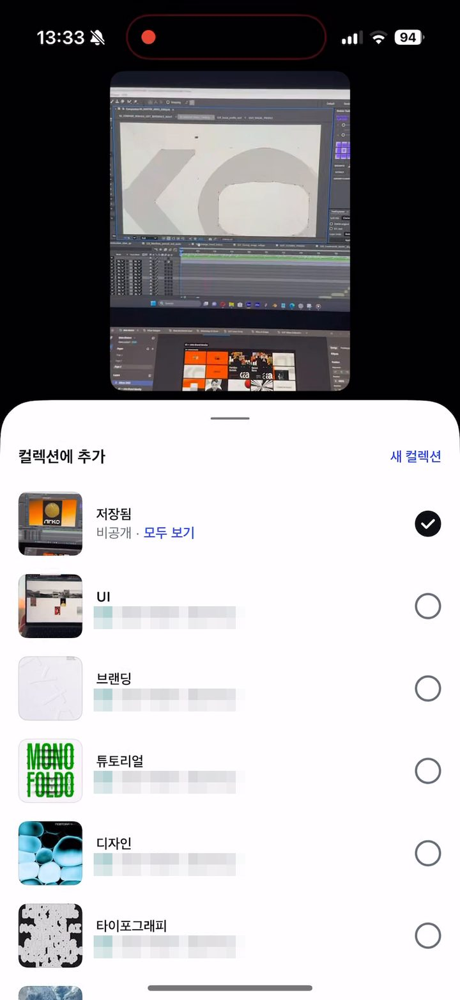
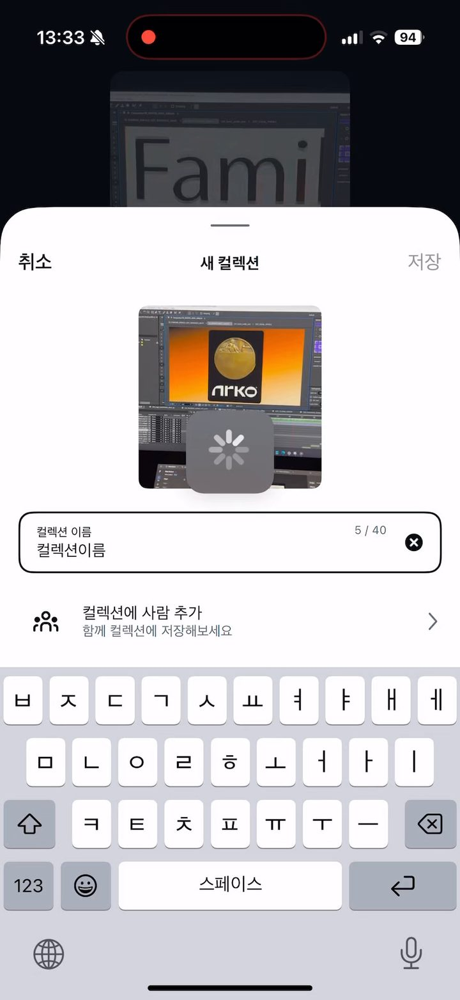
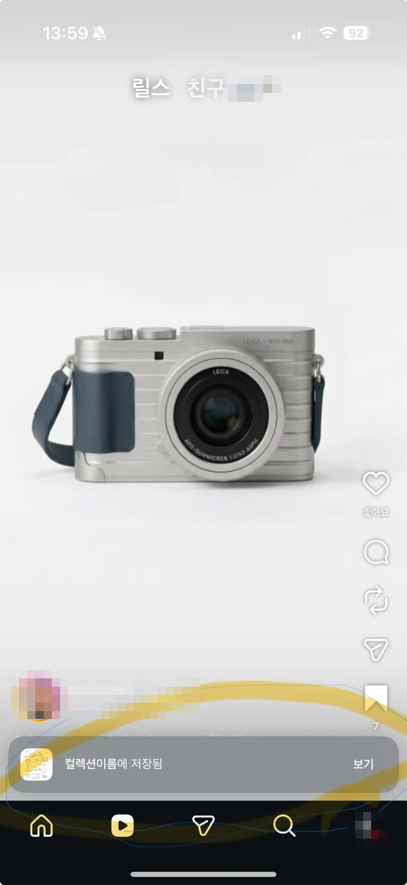
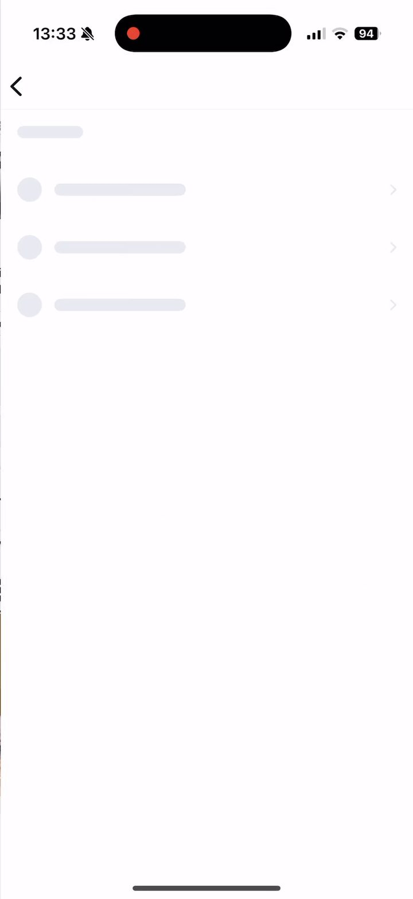
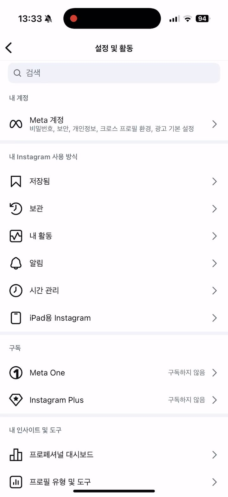
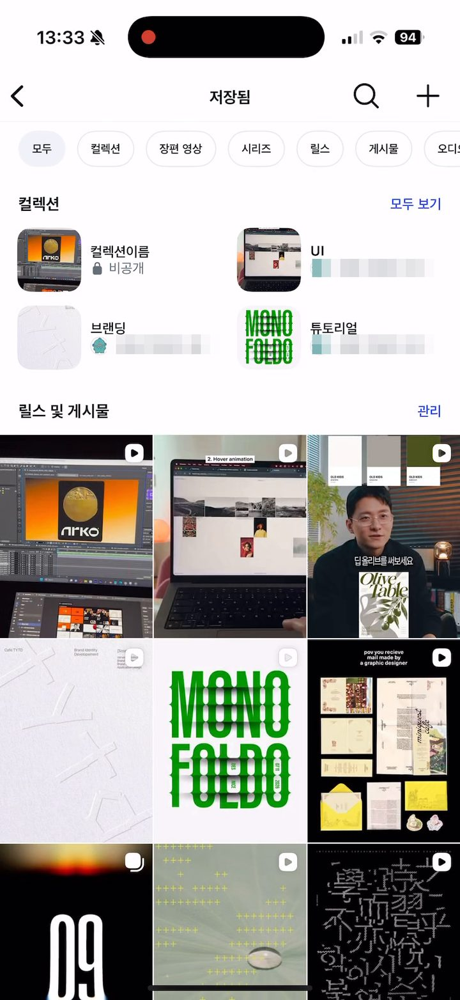
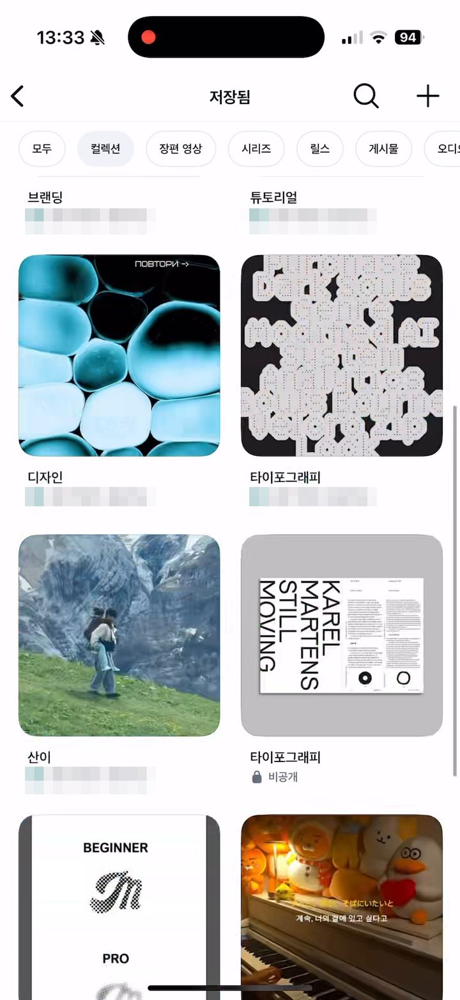
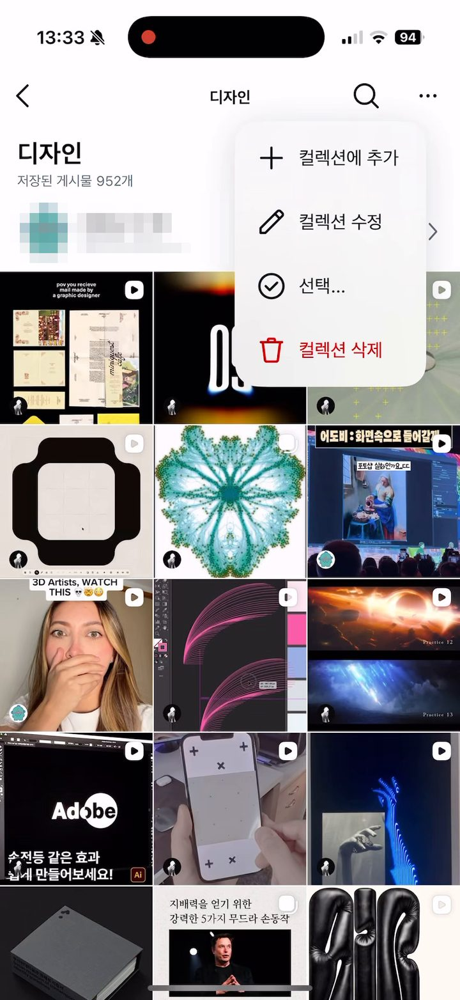
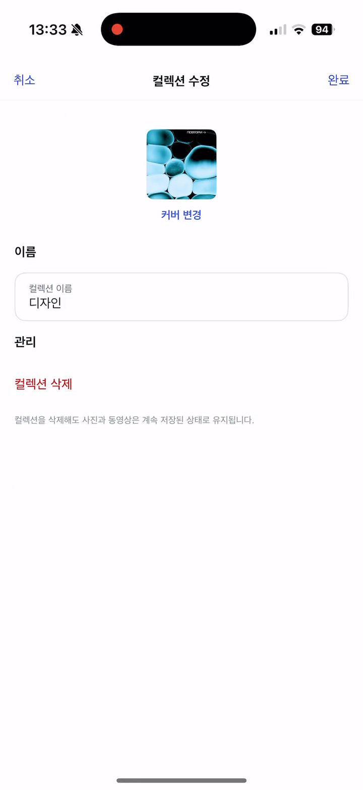
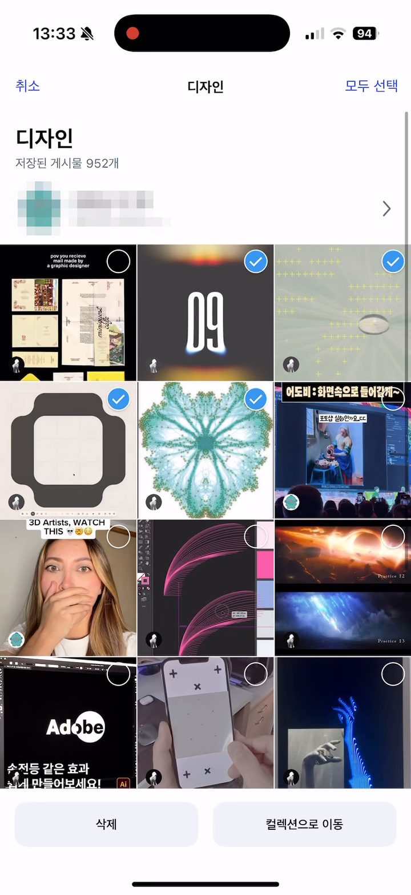

# 휴리스틱 평가 — Saved 사용 흐름에서 무엇이 문제인가

2026-11-17. 진행 순서 1단계. 판정과 심각도는 에이전트 초안이며 사용자 확인 전이다.

**방법.** [디자인DB(이모션글로벌), 「UI·UX 디자인 점검을 원한다면? 휴리스틱 평가 A to Z」(2026)](https://www.designdb.com/?menuno=1278&bbsno=3023&siteno=15&act=view&ztag=rO0ABXQAOTxjYWxsIHR5cGU9ImJvYXJkIiBubz0iOTg4IiBza2luPSJwaG90b19iYnNfMjAxOSI%2BPC9jYWxsPg%3D%3D)를 따른다. 평가는 계획 → 평가자 결정 → 실행 → 분석 순서로 진행한다. 실무 사례처럼 **사용 흐름을 단계로 나누고, 단계마다 문제를 찾아 닐슨 10원칙으로 분석**한다. 같은 글이 말하는 한계 — 인터페이스 문제 위주이고 평가자의 편향이 섞인다 — 는 녹화에서 센 탭 수 · 시간(정량)과 5주차 인터뷰로 보완한다.

**근거.**
- 사용자가 자기 계정으로 실제 Saved를 쓴 녹화(「인스타세이브 수행.mp4」, 45초, iPhone). 시각은 `영상 00:SS`로 적는다.
- 녹화에 없는 것은 인스타그램 고객 센터 도움말(2026-11-17 확인)과 5주차 인터뷰([../WK05/deliverables.md](../WK05/deliverables.md))로 보충한다.
- 문제마다 어긋난 원칙을 **[원칙 이름]**으로, 심각도를 닐슨 척도 0~4(1 겉모양 · 2 작음 · 3 큼 · 4 치명적)로 적는다. 잘 된 점은 ✓로 적는다.

---

## 평가 기준 — 제이콥 닐슨의 10가지 사용성 휴리스틱

| 원칙 | 뜻 | Saved에서 보는 것 |
|---|---|---|
| 시스템 상태의 가시성 | 항상 적절한 피드백으로 지금 무엇이 이루어지고 있는지 알린다 | 저장됐는지, 어디에 들어갔는지 알려 주는가 |
| 시스템과 현실의 일치성 | 전문 용어가 아니라 사용자가 실제로 쓰는 단어 · 개념을 쓴다 | 저장함의 자리와 분류 기준이 사용자의 생각과 맞는가 |
| 사용자의 제어 및 자유 | 잘못 실행했을 때 복잡한 단계 없이 빠져나갈 탈출구가 있다 | 잘못 넣은 것을 쉽게 고칠 수 있는가 |
| 일관성과 표준성 | 표준을 따르고, 같은 뜻은 일관되게 표현한다 | 앱 다른 곳의 패턴(고정 등)을 Saved에서도 쓸 수 있는가 |
| 오류 방지 | 에러 메시지보다 실수를 미리 막는 디자인 | 헷갈려서 잘못 넣는 상황을 막는가 |
| 기억보단 인식 | 기억할 부담을 줄이고, 필요한 정보 · 옵션이 화면에 보인다 | 어디에 넣을지, 어디 있는지 기억하지 않아도 되는가 |
| 유연하고 효율적인 사용 | 초보자부터 숙련자까지 단축 · 맞춤 설정으로 빠르게 쓴다 | 자주 하는 일(분류, 다시 꺼내기)을 빠르게 할 수 있는가 |
| 심미적이고 간결한 디자인 | 불필요하거나 드물게 쓰는 정보를 빼 핵심이 드러나게 한다 | 첫 화면에서 중요한 것이 먼저 보이는가 |
| 오류의 인식, 진단 및 복구 지원 | 명확한 언어로 원인을 설명하고 해결책을 제시한다 | 헷갈리는 결과를 말로 풀어 주는가 |
| 도움말과 매뉴얼 | 필요할 때 쉽게 찾아볼 수 있는 도움말이 있다 | 도움말이 지금 앱과 맞는가 |

## 계획 — 과업과 흐름

**사용자의 목적:** 인스타그램에서 저장한 게시물을 다시 보고 싶을 때, 바로 다시 찾는다.

**과업(녹화):** 릴스 하나를 새 컬렉션에 저장하고, 저장함에 들어가 컬렉션을 확인한 뒤, 컬렉션 안 게시물 순서를 바꿔 본다.

| 흐름 단계 | 하는 일 | 영상 | 탭 수 · 시간 |
|---|---|---|---|
| ① 저장하기 | 릴스에서 저장 버튼 → '컬렉션에 추가' 창 | 00:02–00:05 | 1탭 |
| ② 새 컬렉션 만들기 | 새 컬렉션 → 이름 입력 → 저장 | 00:05–00:12 | 2탭 + 이름 입력(약 5초) |
| ③ 저장함 들어가기 | 프로필 → 메뉴(☰) → 설정 및 활동 → 저장됨 (녹화). 지름길: 탐색 탭 → 오른쪽 위 저장 아이콘(사용자 캡처, 2026-11-17) | 00:15–00:21 | 3탭 · 약 5초(로딩 약 2초). 지름길은 2탭(에이전트 셈, 시간은 재지 않음) |
| ④ 둘러보고 찾기 | 저장됨 → 컬렉션 목록 → 컬렉션 | 00:19–00:32 | +1탭 |
| ⑤ 순서 바꾸기 · 정리하기 | '디자인'(952개) → ⋯ → 컬렉션 수정 / 선택... | 00:33–00:44 | 순서 바꾸기는 불가 |

## 평가자

| 평가자 | 1차 — 자유롭게 사용 | 2차 — 원칙별 검토 |
|---|---|---|
| 사용자(디자인 전공, 실제 Saved 사용자) | 자기 계정으로 과업을 수행하고 녹화 | 해결 메모(저장 · 진입 · 찾기) |
| 에이전트 | — | 녹화를 1초 · 0.25초 간격 프레임으로 보고 10원칙에 대어 판정, 도움말과 대조 |

참고 글은 평가자 3~5명을 권한다. 지금은 2명이라, 같은 녹화를 수강생 1~3명에게 보여 판정을 더 받으면 편향이 줄어든다(사용자 결정).

---

## 실행 — 흐름 단계별로 무엇이 문제인가

### ① 저장하기

영상 00:04 — 저장 버튼을 누르자 뜬 '컬렉션에 추가' 창

- **[기억보단 인식] 3** — 창은 컬렉션을 늘어놓기만 하고, 이 게시물에 맞는 곳을 알려 주지 않는다. 목록이 화면 아래로 이어져 많을수록 스크롤해야 하고, 어디에 넣을지는 매번 사용자가 판단한다. 보는 흐름 한가운데서 판단을 요구하니 미루게 된다(5주차: "나눠놓지 않습니다", P2).
- **[도움말과 매뉴얼] 2** — 도움말은 "저장을 길게 누르면" 컬렉션을 고른다고 하고, 릴스는 '옵션 → 저장'이라고 한다. 녹화에서는 릴스 오른쪽 저장 버튼을 누르자 바로 이 창이 떴다(사용자 설명: 클릭). 도움말이 지금 앱과 다르다.
- ✓ **[유연하고 효율적인 사용]** — 저장 한 번에 컬렉션까지 고를 수 있다.
- ✓ **[기억보단 인식]** — 컬렉션이 커버 사진과 함께 보여 이름을 기억하지 않아도 된다.

### ② 새 컬렉션 만들기

 

영상 00:11 이름 직접 입력 · 사용자 캡처(13:59) 저장 뒤 '컬렉션이름에 저장됨 · 보기' 안내

- **[유연하고 효율적인 사용] 2** — 맞는 컬렉션이 없으면 사용자가 흐름을 멈추고 이름을 지어야 한다. 칸에는 '컬렉션 이름'이라는 이름표만 있고 제안이 없다(입력 약 5초).
- ✓ **[시스템 상태의 가시성]** — 저장하면 화면 아래에 "컬렉션이름에 저장됨"과 '보기'가 뜬다(사용자 캡처). 어느 컬렉션에 들어갔는지 알려 준다. 녹화(00:12–00:14)에서는 이 안내가 보이지 않았다 — 새 컬렉션을 만든 직후에는 뜨지 않는지 확인 필요.
- **[유연하고 효율적인 사용]** 참고 — 안내에는 '보기'만 있고 '변경'은 없다. 잘못 넣었으면 ⑤의 옮기기 경로를 거쳐야 한다. '보기'가 어디로 가는지(그 컬렉션인지)는 확인 필요.
- **[오류 방지] 1** — 같은 이름의 컬렉션을 만들 수 있다. 결과는 ④에서 '타이포그래피' 두 개로 나타난다. 사용자는 이를 자신이 잘못 만든 것으로 보고 인사이트에서 뺐다. 시스템이 막지 않는다는 점만 남겨 심각도를 1로 낮춘다.
- ✓ **[오류 방지]** — 이름을 넣기 전에는 '저장'이 꺼져 있다(영상 00:06).
- ✓ **[사용자의 제어 및 자유]** — '취소'로 바로 빠져나올 수 있다.

### ③ 저장함 들어가기

 

영상 00:16 스켈레톤 로딩 · 00:18 '설정 및 활동' 안의 저장됨

> **2026-11-17 고침(사용자 확인):** 탐색 탭 오른쪽 위, 검색창 옆에 저장됨으로 가는 저장(북마크) 아이콘이 있다(사용자 캡처). 뎁스 자체는 줄어 있다. 다만 이름 없이 아이콘만 있고, 이를 모르는 사람이 많을 것이다(사용자 판단 — 유저 테스트로 확인). 아래 두 판정을 이에 맞춰 고쳤다. 고친 심각도는 에이전트 제안이다.

- **[시스템과 현실의 일치성] 3 → 2** — 저장함의 기본 자리는 '설정 및 활동' 화면 안, Meta 계정 · 알림 · 시간 관리 · 구독 · 프로페셔널 대시보드 같은 설정 항목 사이다. 내가 모은 게시물이 설정 메뉴에 들어 있다. 5주차에도 "메뉴 안에 있고 단계가 깊어 더 안 찾게 된다"(P2)는 답이 있었다. 탐색 탭에 지름길이 있어 심각도를 낮춘다.
- **[기억보단 인식] 2** (새) — 지름길은 탐색 탭 검색창 옆의 이름 없는 아이콘이다. 저장한 것을 다시 보려는 사람이 탐색 탭을 떠올리고 그 아이콘을 알아봐야 쓸 수 있다. 녹화에서도 사용자는 지름길이 아니라 프로필 → 메뉴로 갔다.
- ~~[유연하고 효율적인 사용] 2 — 저장함으로 가는 지름길이 없다~~ → 지름길은 있다(탐색 탭, 2탭). 이 판정은 지운다.
- **[도움말과 매뉴얼] 1** — 도움말은 같은 화면을 '저장됨'과 '저장된 항목'으로 섞어 쓴다. 앱 화면 이름은 '저장됨'이다.
- ✓ **[시스템 상태의 가시성]** — '설정 및 활동'이 열리는 동안 스켈레톤 화면을 보여 준다.

### ④ 둘러보고 찾기

 

영상 00:21 저장됨 첫 화면 · 00:29 컬렉션 목록 — '타이포그래피'가 두 개(위는 공동, 아래는 비공개)

- **[심미적이고 간결한 디자인] 2** — 첫 화면의 주인공은 최근에 저장한 게시물 그리드다. 다시 찾을 때 쓰는 컬렉션은 4개만 보인다. 컬렉션만 모아 봐도 2열 큰 커버라 한 화면에 몇 개 안 들어온다(사용자 메모). 우선순위가 높은 것이 앞에 있지 않다.
- **[시스템과 현실의 일치성] 2** — 위 필터가 콘텐츠 형식(모두 · 컬렉션 · 장편 영상 · 시리즈 · 릴스 · 게시물 · 오디오)으로 나뉜다. 사람들이 다시 찾을 때 떠올리는 기준(카페, 레퍼런스처럼 주제나 용도)과 다르다(에이전트 해석).
- **[시스템 상태의 가시성] 2** — 그리드에 게시물이 어느 컬렉션에 들었는지, 분류되지 않았는지 표시가 없다. 정리할 것이 얼마나 남았는지 모른다.
- **[오류 방지] 1** — '타이포그래피'가 두 개다. 저장할 때 어느 쪽에 넣을지 헷갈리고, 찾을 때 두 곳을 다 훑게 된다(사용자 판단: 본인이 잘못 만든 것 — 인사이트에서는 뺌).
- **[기억보단 인식] 2** — 952개가 든 컬렉션 안에서는 저장 순서대로 쌓인 썸네일을 훑거나 검색어를 기억해 넣어야 한다. 자주 보는 게시물도 어디쯤 있는지 기억에 기댄다. 무엇으로 검색되는지(본문 · 계정 이름)는 녹화에 없어 확인 필요.
- **[시스템 상태의 가시성] 1** — 952개짜리 컬렉션을 열 때 빈 화면에 스피너만 2초 가까이 보인다(영상 00:30–00:31). 설정 화면의 스켈레톤과 다르다.
- **[심미적이고 간결한 디자인] 1** — 컬렉션마다 '공동 작업자: …'가 반복되다 잘린다. 반면 몇 개가 들었는지는 안에 들어가야 보인다.
- ✓ **[일관성과 표준성]** — 저장됨과 컬렉션 안이 같은 틀(제목 · 검색 · ⋯ · 그리드)이다.
- ✓ **[유연하고 효율적인 사용]** — 저장됨과 컬렉션 안에 검색 버튼이 있다.

### ⑤ 순서 바꾸기 · 정리하기

  

영상 00:33 ⋯ 메뉴 · 00:34 컬렉션 수정 · 00:42 선택 화면 — 어디에도 순서 바꾸기 · 고정이 없다

- **[유연하고 효율적인 사용] 3** — 컬렉션 안에서 순서를 바꾸거나 게시물을 위에 고정할 수 없다. ⋯ 메뉴(컬렉션에 추가 · 컬렉션 수정 · 선택... · 컬렉션 삭제), 컬렉션 수정(커버 · 이름 · 삭제), 선택 화면(삭제 · 컬렉션으로 이동) 어디에도 없다. 952개를 모은 사용자일수록 자주 보는 게시물이 저장 순서에 묻힌다. 5주차에는 꼭 다시 볼 것을 자기에게 DM으로 보내 두는 우회가 나왔다(P4). 카카오톡이 이모티콘 순서 변경으로 숙련 사용자를 돕는 것과 대비된다.
- **[사용자의 제어 및 자유] 3** — 잘못 넣은 게시물을 옮기려면 프로필 → 메뉴 → 저장됨 → 컬렉션 → ⋯ → 선택... → 게시물 → 컬렉션으로 이동 → 컬렉션 고르기를 거친다. 홈에서 약 10탭이다(마지막 두 단계는 도움말 기준). 탐색 탭 지름길로 들어가면 한 탭 줄어든다(에이전트 셈). 저장할 때 한 선택에서 빠져나갈 탈출구가 멀다. 5주차: "이동하는 게 번거롭다 … 그냥 폴더 한 개만 더 훑지 뭐"(P4).
- **[일관성과 표준성] 2** — 인스타그램은 프로필 게시물 고정(최대 3개)과 채팅 메시지 고정을 지원한다(도움말). 앱 다른 곳에서 익힌 고정을 저장함에서는 쓰지 못한다.
- **[오류의 인식, 진단 및 복구 지원] 1** — 도움말에 따르면 '컬렉션에서 삭제'해도 게시물은 저장된 채 남고, 완전히 지우려면 따로 '저장 취소'를 해야 한다. 도움말이 '참고'로 따로 안내할 만큼 헷갈리는 지점이다(앱 확인 필요).
- ✓ **[오류 방지]** — 컬렉션을 지워도 게시물은 남고, 화면이 그렇게 알려 준다("컬렉션을 삭제해도 사진과 동영상은 계속 저장된 상태로 유지됩니다"). 게시물을 고르기 전에는 '삭제' · '컬렉션으로 이동'이 꺼져 있고, '컬렉션 삭제'는 빨간 글씨로 구분된다.

---

## 분석

### 흐름 × 원칙

숫자는 심각도, ✓는 잘 된 점이다.

| 원칙 | ① 저장 | ② 새 컬렉션 | ③ 들어가기 | ④ 둘러보고 찾기 | ⑤ 순서 · 정리 |
|---|---|---|---|---|---|
| 시스템 상태의 가시성 | | ✓ | ✓ | 2 · 1 | |
| 시스템과 현실의 일치성 | | | 2 (3에서 낮춤) | 2 | |
| 사용자의 제어 및 자유 | | ✓ | | | **3** |
| 일관성과 표준성 | | | | ✓ | 2 |
| 오류 방지 | | 1 · ✓ | | 1 | ✓ |
| 기억보단 인식 | **3** · ✓ | | 2 (새) | 2 | |
| 유연하고 효율적인 사용 | ✓ | 2 | ✓ (지름길 있음) | ✓ | **3** |
| 심미적이고 간결한 디자인 | | | | 2 · 1 | |
| 오류의 인식, 진단 및 복구 지원 | | | | | 1 |
| 도움말과 매뉴얼 | 2 | | 1 | | |

### 무엇이 가장 큰 문제인가

심각도 3 세 가지(2026-11-17 탐색 탭 지름길 확인 뒤, 네 가지에서 하나가 2로 내려감 — 에이전트 제안):

| 흐름 단계 | 문제 | 원칙 | 축 |
|---|---|---|---|
| ⑤ 순서 · 정리 | 컬렉션 안 순서 변경 · 고정이 없다 | 유연하고 효율적인 사용 | 제어 |
| ① 저장 | 어디에 넣을지 알려 주지 않는다 | 기억보단 인식 | 저장 |
| ⑤ 순서 · 정리 | 잘못 넣은 것을 옮기는 데 약 10탭 | 사용자의 제어 및 자유 | 제어 |

심각도 2: 저장함의 기본 자리가 설정 화면 안(시스템과 현실의 일치성, 3에서 낮춤), 탐색 탭 지름길이 이름 없는 아이콘(기억보단 인식, 새), 그리드에 분류 표시 없음(시스템 상태의 가시성), 이름 직접 입력(유연하고 효율적인 사용), 첫 화면 우선순위 · 큰 커버(심미적이고 간결한 디자인), 형식 기준 필터(시스템과 현실의 일치성), 952개 안 훑기(기억보단 인식), 프로필 · 채팅과 다른 고정(일관성과 표준성), 도움말이 앱과 다름(도움말과 매뉴얼).

**흐름으로 보면** 문제는 양 끝에 몰린다. 저장할 때(①②)는 어디에 들어갔는지는 알려 주지만, 어디에 넣을지 판단을 돕지 않는다. 다시 꺼낼 때(④⑤)는 앞에 둘 수단이 없고 고치기 비싸다. 그 사이(③)는 탐색 탭에 지름길이 있지만 이름 없는 아이콘이라, 모르면 설정 속을 거쳐야 한다.

**원칙으로 보면** 기억보단 인식(①④) · 시스템과 현실의 일치성(③④) · 유연하고 효율적인 사용(②③⑤)에 문제가 몰린다. 저장할 때 판단을 대신 덜어 주지 않고, 저장함의 자리와 분류 기준이 사용자의 생각과 다르며(지름길은 있지만 알아봐야 쓴다), 다시 꺼내는 일을 빠르게 해 주지 않는다.

**녹화와 캡처로 바로잡은 것.**
- 도움말만 보고 쓴 첫 초안에서는 '컬렉션 고르기가 길게 누르기 뒤에 숨어 있다'고 봤다. 녹화에서는 저장 버튼만 눌러도 창이 떴다. 저장 쪽 문제는 고를 기회가 없는 것이 아니라 **고르는 판단을 돕지 않는 것**이다. 저장함 안 검색도 있었다.
- 녹화 판에서는 '저장 뒤 어느 컬렉션인지 안내가 없다'(시스템 상태의 가시성 2)고 봤다. 사용자 캡처에서 "컬렉션이름에 저장됨 · 보기" 안내가 확인되어 잘 된 점으로 옮겼다.
- '같은 이름 컬렉션'은 사용자가 본인 실수로 판단해, 심각도를 2에서 1로 낮췄다.

### 저장 · 진입,탐색 · 제어 축으로 (2026-11-17 축 정리에 맞춰 고침)

- **저장:** ① 기억보단 인식(3), ② 유연하고 효율적인 사용(2) · 오류 방지(1)
- **진입,탐색:** ③ 시스템과 현실의 일치성(2) · 기억보단 인식(2, 지름길이 이름 없는 아이콘), ④ 심미적이고 간결한 디자인 · 기억보단 인식 · 시스템과 현실의 일치성(2)
- **제어:** ⑤ 유연하고 효율적인 사용(3) · 사용자의 제어 및 자유(3) · 일관성과 표준성(2)

해결 방향은 [insight-solution.md](./insight-solution.md)에 있다.

### 한계와 보완

- 참고 글이 말하듯 휴리스틱 평가는 인터페이스 문제 위주이고, 평가자의 경험이 판단에 섞인다. 평가자도 2명뿐이다.
- 보완: 녹화에서 센 탭 수 · 시간(정량), 5주차 인터뷰(사용자의 말)를 근거로 붙였다. 다음 단계의 카드 소팅(진입)과 유저 테스트(태스크별 0~10점)로 판정을 다시 확인한다.

## 남은 확인

- 저장 버튼을 그냥 눌렀는지 길게 눌렀는지(녹화로는 구분되지 않음). 게시물(릴스가 아닌 것)에서도 같은 창이 뜨는지.
- 새 컬렉션을 만든 직후에도 '저장됨 · 보기' 안내가 뜨는지(녹화에서는 안 보임), '보기'가 어디로 가는지.
- 저장됨 검색이 무엇으로 찾는지.
- 평가자 추가(수강생 1~3명) 여부.

## 출처

- 녹화: 「인스타세이브 수행.mp4」(사용자, 2026-11-17, 45초). 영상은 올리지 않고 캡처 10장만 `img/`에 둔다. 저장 안내 화면(`img/11-saved-toast.jpg`)은 사용자가 따로 보낸 캡처(13:59)이고, 노란 표시는 사용자가 그린 것이다. 계정명 · 공동 작업자 이름 · 릴스 작성자와 설명은 모자이크로 가렸다(사용자 결정). 프로필 화면은 넣지 않았다.
- 평가 방법: [디자인DB(이모션글로벌), UI·UX 디자인 점검을 원한다면? 휴리스틱 평가 A to Z (2026)](https://www.designdb.com/?menuno=1278&bbsno=3023&siteno=15&act=view&ztag=rO0ABXQAOTxjYWxsIHR5cGU9ImJvYXJkIiBubz0iOTg4IiBza2luPSJwaG90b19iYnNfMjAxOSI%2BPC9jYWxsPg%3D%3D) · 이전 판에서 참고: [미경, 휴리스틱 평가는 어떻게 하는 것인가? (브런치, 2024)](https://brunch.co.kr/@migyeongux/57) · [Diby, UI 휴리스틱 평가 10원칙 — 카톡으로 알아보기 (Medium, 2023)](https://medium.com/diby-uxresearchops/ui-%ED%9C%B4%EB%A6%AC%EC%8A%A4%ED%8B%B1-%ED%8F%89%EA%B0%80-10%EC%9B%90%EC%B9%99-%EC%B9%B4%ED%86%A1%EC%9C%BC%EB%A1%9C-%EC%95%8C%EC%95%84%EB%B3%B4%EA%B8%B0-7e26fea7921e)
- 인스타그램 고객 센터(iPhone 앱 도움말, 2026-11-17 확인): [게시물 저장하기](https://help.instagram.com/1744643532522513) · [저장한 게시물로 컬렉션 만들기](https://help.instagram.com/274531543007118) · [컬렉션 관리하기](https://help.instagram.com/1524436600950937) · [공동 컬렉션 만들기](https://help.instagram.com/3129045784070725) · [프로필 게시물 고정](https://help.instagram.com/318456537074409/) · [채팅 메시지 고정](https://help.instagram.com/480710684368336/)
